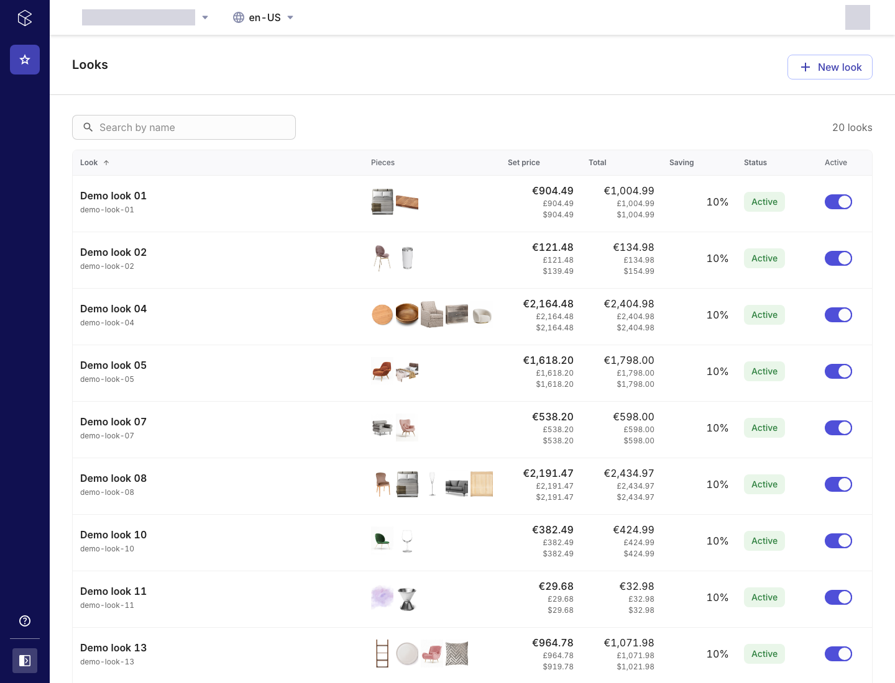

# Looks

Looks is a Merchant Center custom application for curated looks: a few products sold together as one set, at a single set price that is lower than the pieces cost on their own. Merchandisers build a look from existing products, set its price per currency and country, and switch it on or off, all from the Merchant Center. No ticket and no deployment is needed for a new look or a price change.

It is useful in two ways. If your store sells bundles or outfits, it is a working feature you can run. If you build Merchant Center custom applications, it is a complete example: a four-step creation flow, product search, per-country prices, optimistic concurrency on every write, and a Connect deployment, all in one codebase.



> **Unsupported reference code.** Looks is shared under the MIT license to learn from, adapt and reuse. It is not covered by commercetools support, so there are no guaranteed replies or fixes. See [`SUPPORT.md`](./SUPPORT.md).

## What it does

- **Lists looks** with status switches, search by name, sorting, paging, and warnings for half-written looks or drifted prices.
- **Creates a look in four steps:** basics (name and key), pieces (product search over name, SKU and keywords), set price (per currency and country, as a percentage or an amount), and a review where you can switch the look on straight away.
- **Shows a look in detail:** its pieces, its price table, repair of a look that lost a resource, and deletion with a confirmation.
- **Shows past looks:** every switched-off look with its active period and the sales of the last 90 days.
- **Speaks German and English**, with the project's own currencies and languages.

## How a look is stored

A look is several commercetools resources that share the key `look-<lookKey>`:

- a **Custom Object** in the container `look` with the pieces, the set price per price cell and an optional switch-off time;
- one **Discount Group** `look-<lookKey>`, whose name is the look name, whose `sortOrder` is the look's rank and whose `isActive` is the switch;
- one **Cart Discount** per country with set prices, inside the group. These discounts decide what shoppers pay.

Prices come from the master variant's list prices that are valid now. A percentage gives a relative discount, a set price an absolute one.

## Prerequisites

- Node.js 22 (see [`mc-looks-app/.nvmrc`](./mc-looks-app/.nvmrc)) and npm
- A commercetools project, and a Merchant Center custom application registered for it (the steps are in [`docs/SETUP.md`](./docs/SETUP.md))

## Run it locally

```shell
cd mc-looks-app
npm install
cp ../.env.example .env.local   # set INITIAL_PROJECT_KEY, CUSTOM_APPLICATION_ID, ...
npm start                       # development server on http://localhost:3001
```

From `mc-looks-app/`:

| Command | Does |
|---|---|
| `npm test` | Runs the Jest specs (domain logic, components, GraphQL layer) |
| `npm run lint` | Runs ESLint |
| `npm run typecheck` | Runs TypeScript without emitting files |
| `npm run build` | Builds the production bundle into `public/` |

## Deploy on Connect

The repository is a Connect connector. [`connect.yaml`](./connect.yaml) declares one application, `mc-looks-app`, of type `merchant-center-custom-application`. Connect builds it from the folder of the same name. The deployment takes the Custom Application ID, the entry point path, the initial project key and the cloud identifier; Connect provides the application's own URL. The full sequence, including the Merchant Center registration, is in [`docs/SETUP.md`](./docs/SETUP.md).

## Configuration

Two catalog settings are read in [`mc-looks-app/src/config.ts`](./mc-looks-app/src/config.ts):

- `VARIANT_ATTRIBUTES` (default `size`) names the product-variant attributes that tell variants apart, for example `search-color,search-finish,size`. Variants show as their attribute values, such as "Beige / Linen / 45x45".

Everything else is read from the project: currencies, languages, prices and stock.

## Repository layout

- [`mc-looks-app/`](./mc-looks-app/): the application, its own npm project
- [`connect.yaml`](./connect.yaml): the Connect connector declaration
- [`docs/SETUP.md`](./docs/SETUP.md): registration, deployment and configuration
- [`docs/screenshots/`](./docs/screenshots/): the screenshots used here
- [`.env.example`](./.env.example): the variables for local development and deployment

## License

MIT. See [`LICENSE`](./LICENSE).
